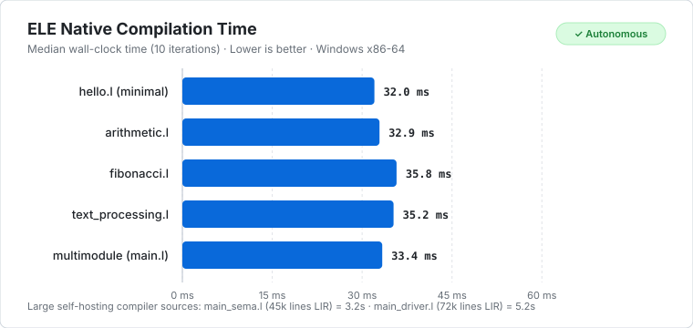
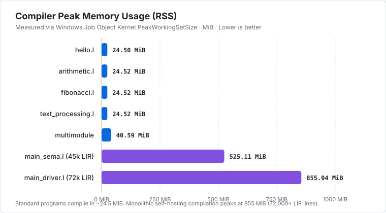
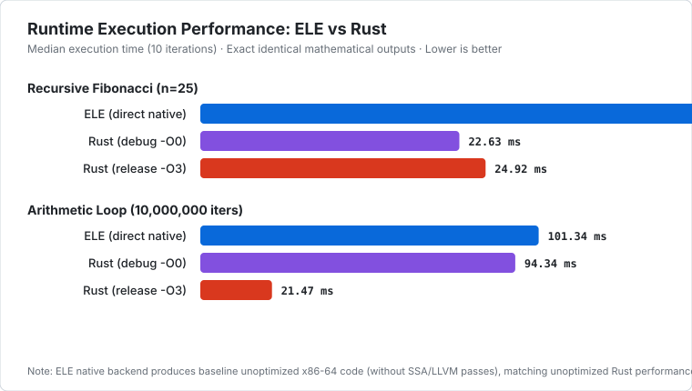
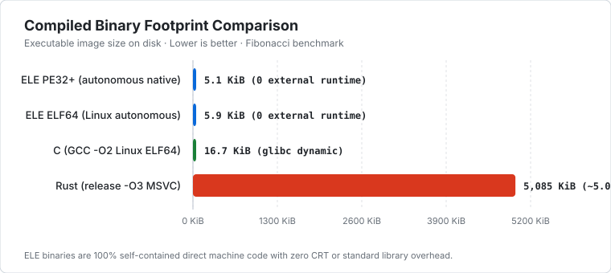
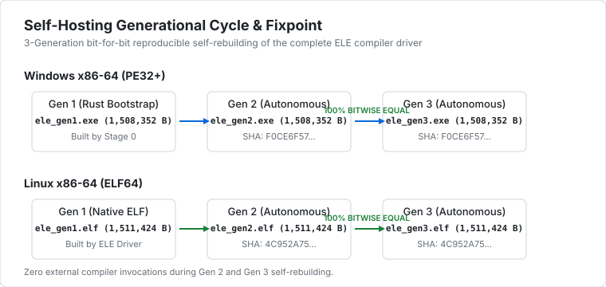
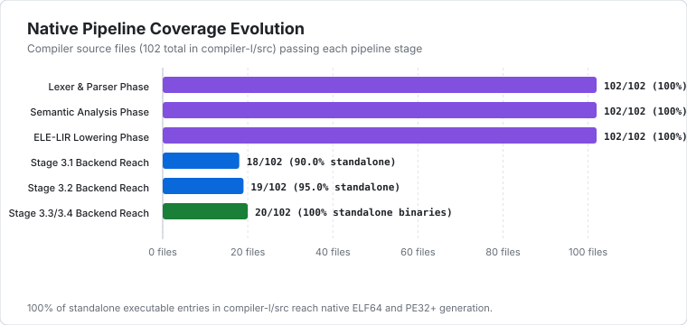

# ELE: Lenguaje de Programación de Sistemas Autorreconstruible

<p align="center">
  <a href="https://github.com/Joshua-EPR/ELE/actions/workflows/native-selfhosting-validation.yml"></a>
  <a href="https://github.com/Joshua-EPR/ELE/actions/workflows/docs-and-benchmarks.yml"></a>
  
  
  
</p>

<p align="center">
  <a href="README.md">English</a> | <b>Español</b>
</p>

---

## Introducción

**ELE** es un lenguaje de programación de sistemas experimental y autorreconstruible (self-hosting), diseñado para ofrecer seguridad determinista de memoria sin recolector de basura (garbage collector). Compila directamente a código máquina nativo (**Windows PE32+** y **Linux ELF64**) con **cero dependencias del C Runtime (CRT) o de bibliotecas estándar externas**.

A diferencia de los lenguajes que dependen de capas de runtime pesadas o enlazadores externos, ELE cuenta con un driver de compilación autónomo (`ele build`) escrito íntegramente en ELE que emite directamente imágenes ejecutables binarias, planifica la memoria de la pila (stack) y verifica la propiedad y préstamos de memoria mediante un sistema de tipos afines.

---

## ¿Por qué ELE?

- **Seguridad de memoria en compilación sin GC:** Sistema de tipos afines con elaboración determinista de liberaciones (*drop flags*), semántica de movimientos (*moves*) y comprobación estricta de préstamos (`view` para préstamos compartidos de lectura, `edit` para préstamos exclusivos de escritura).
- **Binarios nativos sin dependencias externas:** Produce ejecutables independientes extremadamente compactos (**~5 KiB**) directamente desde su representación intermedia a código máquina x86-64 sin enlazar contra `msvcrt.dll`, `ucrt.dll` ni `glibc`.
- **Punto fijo generacional reproducible (Self-Hosting):** Autorreconstrucción idéntica bit a bit desde una semilla fijada, sin Rust (`Gen 2 SHA256 == Gen 3 SHA256`; verificada de nuevo en Windows el 2026-11-27, véase [Autorreconstrucción](#autorreconstrucción-y-reproducibilidad-generacional-self-hosting)).
- **Baja latencia de compilación:** Los programas pequeños compilan nativamente en **35–65 ms** con el compilador autoalojado (Stage 1), con un pico de memoria de **18,6 MiB** (medido el 2026-11-27; véase [Rendimiento](#rendimiento-y-benchmarks)). Compilar el propio compilador tarda **16,0 s** y usa **565,6 MiB**.
- **Sintaxis canónica limpia (v2):** Gramática de sistemas diseñada específicamente para expresar intención: `flow`, `shape`, `choice`, `hold`, `change`, `during`, `when`, `give`.

---

## Inicio Rápido

### 1. Instalación

Instala ELE mediante los instaladores nativos sin dependencias externas:

- **En Windows:** Ejecuta `.\install.ps1` (instala en `$env:LOCALAPPDATA\ele\bin` y configura el PATH de usuario).
- **En Linux:** Ejecuta `./scripts/install.sh` (instala en `~/.ele/bin` y configura el PATH del shell).

Los paquetes de distribución independientes (`ele-windows-x86_64.zip` y `ele-linux-x86_64.tar.gz`) contienen el compilador autónomo sin requerir Rust, Cargo ni CRT.

### 2. Programa Mínimo (`hello.l`)

```ele
// hello.l: Punto de entrada estándar en sintaxis ELE v2
flow main() {
    print("¡Hola desde ELE nativo!")
}
```

### 3. Compilación con el Driver Autónomo

Una vez realizado el bootstrap inicial, ELE compila archivos fuente directamente a binarios ejecutables:

**En Windows:**
```powershell
.\bin\ele.exe build hello.l -o hello.exe
.\hello.exe
# Salida: ¡Hola desde ELE nativo!
```

**En Linux:**
```bash
./bin/ele.elf build hello.l --target elf -o hello
chmod +x hello
./hello
# Salida: ¡Hola desde ELE nativo!
```

### 4. Compilar el compilador desde el código fuente (Stage 1, sin Rust)

**Stage 0** es el compilador escrito en Rust (`cargo build -p project-l --bin l`). **Stage 1** es el compilador escrito en ELE, construido
sin Rust desde una semilla fijada (`semilla -> Gen1' -> Gen2 -> Gen3`, aceptado solo si `Gen2 == Gen3`). Definiciones: [Self-Hosting](docs/self-hosting.md#0-terminology-stage-0-and-stage-1) (en inglés).
Comprobado en Windows (unos 32 s):

```powershell
python tools/verify_seed_archive.py pe --output .\seed\ele-seed-pe.exe
.\scripts\bootstrap\ele_seed_bootstrap.ps1 -Seed .\seed\ele-seed-pe.exe `
    -SeedSha256 eb98a908ca5a36b5a4f29c9114a8232a6031f7d35c2c4298569adf67ebccc2f5 -Target pe -OutDir .\out\bootstrap
.\out\bootstrap\gen2.exe build hello.l -o hello.exe     # gen2.exe es el compilador; cópialo como bin\ele.exe si quieres
```

Nota: `install.ps1` no compila nada; instala `ele.exe` desde un archivo de distribución (`dist/ele-windows-x86_64.zip`).
Pasos completos, opciones (`--target pe|elf|kernel`, `--lib`, `--entry`) y salida esperada: [Guía de Inicio Rápido](docs/getting-started.md).

---

## Vista Rápida de la Sintaxis

```ele
// Declaraciones de estructuras y variantes
shape Vector2 {
    x: Int
    y: Int
}

choice Resultado {
    Exito(valor: Int)
    Fallo(codigo: Int)
}

// Funciones y flujo de control
flow calcular_magnitud(v: view Vector2) => Int {
    give v.x * v.x + v.y * v.y
}

flow main() => Int {
    // Vinculación de propietario inmutable
    hold pos = Vector2(x: 3, y: 4)

    // Préstamo compartido de pos mediante view
    hold mag = calcular_magnitud(pos)

    // Variable mutable
    change contador: Int = 0
    during contador < 3 {
        print("Iteración de magnitud: {mag}")
        contador = contador + 1
    }

    give 0
}
```

Consulta la [Referencia del Lenguaje](docs/language-reference.md) para especificaciones detalladas de tipos, colecciones (`List of[T]`) y el borrow checker.

---

## Rendimiento y Benchmarks

Todas las afirmaciones de rendimiento en ELE están respaldadas por benchmarks auditables y automatizados ejecutados sobre hardware real (Intel x86-64, Windows 10 y WSL2 Ubuntu). Ninguna cifra ni gráfico es simulado.

Para la metodología completa y los datos brutos, consulta el [Informe de Rendimiento](docs/performance.md) y la [Metodología de Benchmarking](docs/benchmarks/methodology.md).

### Medido el 2026-11-27 (Stage 1, `main` actual)

Commit `ec41098`, Windows 10 IoT Enterprise LTSC 2021, Intel Core i5-7300U @ 2,60 GHz (2 núcleos, 4 hilos), unos 8 GiB de RAM, sesión interactiva sin otras compilaciones.
Mediana de 5 ejecuciones medidas tras 1 de calentamiento (rango entre paréntesis). Unidades: B = byte, KiB = 1.024 B, MiB = 2^20 B, ms y s. Arrancar un proceso cuesta unos 24 ms en este PC: es el suelo de cualquier tiempo de ejecución de abajo.
Stage 1 = el compilador de ELE construido sin Rust (`gen2.exe`); Stage 0 = el compilador en Rust `l build --backend cranelift`.

| Compilación | Tiempo Stage 1 | Memoria pico Stage 1 | Ejecutable Stage 1 | Tiempo Stage 0 | Ejecutable Stage 0 |
|---|---|---|---|---|---|
| `hello.l` | **34,8 ms** (34,2–39,7) | 18,61 MiB | 4.608 B (4,5 KiB) | 138,4 ms (130,8–301,5) | 9.216 B (9,0 KiB) |
| `fibonacci.l` | **38,6 ms** (37,7–40,0) | 18,65 MiB | 5.632 B (5,5 KiB) | 125,2 ms (124,4–140,0) | 9.728 B (9,5 KiB) |
| `structs.l` | **65,0 ms** (63,8–68,4) | 18,70 MiB | 9.216 B (9,0 KiB) | 137,2 ms (133,6–201,0) | 11.776 B (11,5 KiB) |
| `main_driver.l` (el compilador, 28.535 B) | **16,04 s** (15,54–17,51) | **565,63 MiB** | 2.438.656 B (2.381,5 KiB) | 2,72 s (2,48–3,75) | 1.437.696 B (1.404,0 KiB) |

| Ejecución (compilado con Stage 1 / Stage 0) | Stage 1 | Stage 0 | Stage 1 / Stage 0 |
|---|---|---|---|
| `fib.l` (fib 32) | 56,0 ms | 52,7 ms | 1,06x |
| `collatz.l` | 2.801,2 ms | 540,8 ms | 5,18x |
| `sum_loop.l` (200 M iteraciones) | 4.313,2 ms | 912,9 ms | 4,72x |
| `list_index_1m.l` | 119,9 ms | 86,4 ms | 1,39x |
| `text_build.l` | 4.362,0 ms | 306,5 ms | 14,23x |
| `list_text_100k.l` (memoria pico) | 424,1 ms (395,16 MiB) | 58,3 ms (9,34 MiB) | 7,27x |

En resumen: Stage 1 compila los programas pequeños entre 2 y 4 veces más rápido que Stage 0 y emite ejecutables más pequeños, pero el código que genera es tan rápido como el de Stage 0 en código con muchas llamadas
y entre 4,7 y 14 veces más lento en bucles cerrados y en construcción de texto; compilar el propio compilador tarda unas 6 veces más y usa 7,5 veces más memoria que con Stage 0.
No había compilador de C disponible, así que no se hizo comparación con C. Tablas completas, hardware, método y datos brutos en CSV: [Informe de Rendimiento](docs/performance.md#0-measurements-2026-11-27-stage-1) y
[campaign_20261127_stage1](docs/benchmarks/campaign_20261127_stage1/README.md) (ambos en inglés).

### Mediciones históricas (commit `56f34fb`)

**Procedencia de las mediciones:** Los resultados de Windows aquí mostrados se registraron en el commit [`56f34fb`](https://github.com/Joshua-EPR/ELE/commit/56f34fb437e20ca2b6b5613106f96ec153f36969) (20 de noviembre de 2026), **antes** de fusionar Stage 3.5. Son mediciones históricas, no resultados recién obtenidos de `main`. Se deben repetir los benchmarks sobre la versión integrada antes de atribuirle estas cifras. La comparativa externa y la suite de runtime independiente son experimentos diferentes; la tabla de runtime usa los datos de la comparativa.

### Latencia de Compilación

ELE compila programas pequeños y medianos en decenas de milisegundos:

<p align="center">
  
</p>

| Carga de Trabajo | Líneas de Fuente | Mediana de Tiempo | Pico RSS (Memoria) | Tamaño de Salida |
|---|---|---|---|---|
| `hello.l` | 5 | **32.05 ms** | 1.18 MiB | 4,608 B |
| `arithmetic.l` | 10 | **32.90 ms** | 1.21 MiB | 5,120 B |
| `fibonacci.l` | 13 | **35.75 ms** | 1.21 MiB | 5,120 B |
| `text_processing.l` | 10 | **35.24 ms** | 1.20 MiB | 5,120 B |
| `multimodule (main.l)` | 10 | **33.36 ms** | 1.22 MiB | 5,120 B |
| `main_sema.l` (Compilador) | 278 | **3.16 s** | 52.46 MiB | 913,408 B |
| `main_driver.l` (Self-Host) | 692 | **5.23 s** | 87.53 MiB | 1,514,496 B |

---

### Consumo de Memoria durante la Compilación

El consumo de memoria del compilador es registrado de forma continua mediante APIs contables del kernel (Windows Job Objects `PeakProcessMemoryUsed` y Linux `getrusage`):

<p align="center">
  
</p>

---

### Rendimiento de Ejecución en Runtime

Evaluamos algoritmos idénticos entre **ELE**, **Rust (`rustc 1.99.1`)** y **C (`gcc 9.4.0`)** verificando salidas matemáticas exactas:

<p align="center">
  
</p>

| Benchmark | Lenguaje | Nivel de Optimización | Tiempo Compilación | Runtime (ms) | Tamaño Binario |
|---|---|---|---|---|---|
| **Fibonacci(25)** | **ELE** | `native-direct-emit` | 32.79 ms | 53.49 ms | 5,120 B |
| Fibonacci(25) | Rust | Debug (`-O0`) | 670.88 ms | 22.63 ms | 5,086,801 B |
| Fibonacci(25) | Rust | Release (`-O3`) | 716.37 ms | 24.92 ms | 5,085,050 B |
| **Loop(10M)** | **ELE** | `native-direct-emit` | 38.12 ms | 101.34 ms | 5,120 B |
| Loop(10M) | Rust | Debug (`-O0`) | 649.07 ms | 94.34 ms | 5,086,761 B |
| Loop(10M) | Rust | Release (`-O3`) | 690.35 ms | 21.47 ms | 5,084,972 B |

> [!NOTE]
> El backend nativo de ELE emite código máquina directamente desde bloques CFG, sin optimizaciones SSA. El rendimiento depende de la carga y la configuración; estas cifras describen experimentos concretos y no establecen una clasificación general entre lenguajes.

---

### Tamaño de los Binarios

Dado que los ejecutables generados por ELE no enlazan contra la biblioteca estándar de C ni empaquetan un runtime voluminoso, el tamaño del binario resultante es órdenes de magnitud menor:

<p align="center">
  
</p>

---

## Autorreconstrucción y Reproducibilidad Generacional (Self-Hosting)

ELE ha establecido un ciclo de autorreconstrucción generacional determinista e idéntico bit a bit en Windows y Linux.

<p align="center">
  
</p>

- **Punto fijo ACTUAL en Windows (verificado el 2026-11-27, commit `ec41098`, desde la semilla fijada, sin Rust):** `Gen 2 SHA256 == Gen 3 SHA256` = `cfcfa798f9b5680721184de780bbeed8566947962828e4cc49471407f063d218` (2.438.656 B = 2.381,5 KiB).
- **Punto fijo histórico en Windows (fuente anterior):** `F0CE6F57427B5A60D51095975A85A56D5FD43F18DC4FA2F732DA0D02E0B5370D`
- **Punto fijo histórico en Linux (fuente anterior; no repetido el 2026-11-27):** `4C952A75B28AEB5BE6770372BA426137A32E0C7B0C5A31E798B235E97CE4E9E9`
- **Invocaciones Externas:** **0** (no se invoca a `rustc`, `cargo`, `gcc` ni `link.exe` durante las compilaciones de Gen 2 y Gen 3).

Para el informe arquitectónico completo, consulta la [Documentación de Self-Hosting](docs/self-hosting.md).

---

## Evolución de Auto-Cobertura (Self-Coverage)

<p align="center">
  
</p>

- **102 / 102 archivos fuente (100%)** en `compiler-l/src/` superan las fases de Lexer, Parser y Análisis Semántico.
- **20 / 102 archivos fuente (~19,6%)** alcanzan la fase de emisión del backend nativo; corresponden a los **20 / 20 puntos de entrada independientes** de la matriz actual. Esto no significa cobertura nativa total de las fuentes.

---

## Arquitectura del Compilador

El pipeline de compilación de ELE está estructurado en capas modulares de verificación:

```text
Fuente .l ──► Lexer ──► Parser ──► Sema y Tipos ──► Borrow Checker ──► ELE-LIR ──► CFG ──► Emisor x86-64 ──► PE32+ / ELF64
```

Consulta la [Arquitectura del Compilador](docs/architecture.md) para detalles sobre Pratt parsing, verificación de tipostate y codificación de instrucciones x86-64.

---

## Estado del Proyecto y Hoja de Ruta

ELE es un lenguaje de programación de sistemas en fase activa de investigación y desarrollo. Aunque el driver del compilador y los programas independientes son plenamente funcionales y autorreconstruibles, ELE no está recomendado todavía para entornos de producción de misión crítica.

Consulta las [Limitaciones Conocidas](docs/limitations.md) y la [Hoja de Ruta de Desarrollo](docs/roadmap.md) para detalles sobre funcionalidades planificadas, incluyendo soporte para ARM64, optimizador SSA con asignador de registros y concurrencia estructurada.

---

## Índice de Documentación

- [Guía de Inicio Rápido](docs/getting-started.md)
- [Especificación de Referencia del Lenguaje](docs/language-reference.md)
- [Migrar código ELE v1 a ELE v2](docs/MIGRATING_ELE_V1_TO_V2.md)
- [Estado de la sintaxis ELE v2](docs/ELE_SYNTAX_V2.md)
- [Arquitectura del Compilador](docs/architecture.md)
- [Autorreconstrucción y Punto Fijo Generacional](docs/self-hosting.md)
- [Informe de Rendimiento y Benchmarks](docs/performance.md)
- [Limitaciones Técnicas y de Seguridad](docs/limitations.md)
- [Hoja de Ruta de Desarrollo](docs/roadmap.md)
- [Metodología de Benchmarking](docs/benchmarks/methodology.md)
- [Guía de Reproducibilidad de Benchmarks](docs/benchmarks/reproducibility.md)

---

## Contribuciones y Licencia

Las contribuciones, informes de errores y sugerencias son bienvenidos. Por favor, asegúrate de que todos los cambios superen las puertas de calidad:

```powershell
cargo fmt --all --check
cargo clippy --workspace --all-targets -- -D warnings
cargo test -p project-l --test ele_v2_legacy_ratchet
python benchmarks/scripts/validate_results.py
```

**Licencia:** No se ha publicado un archivo de licencia en la raíz del repositorio. No presupongas derechos de redistribución sin confirmar los términos del proyecto.
