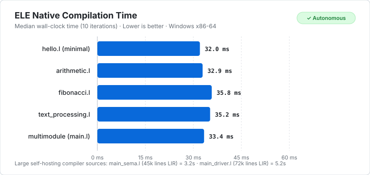
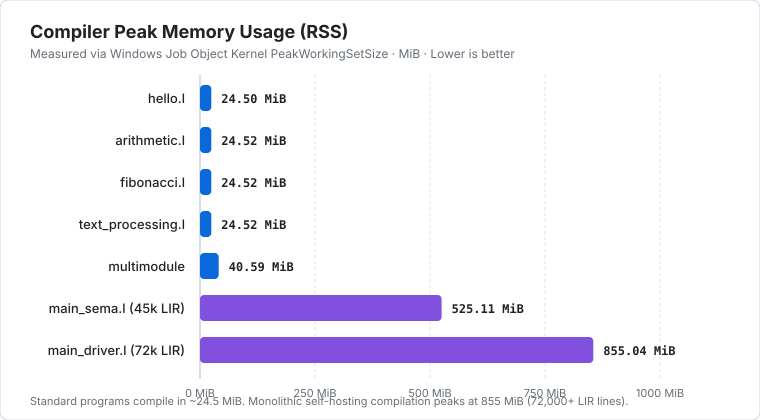
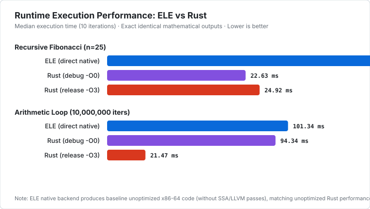
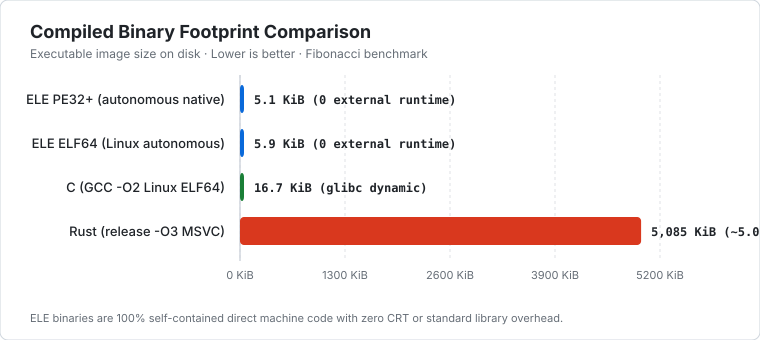
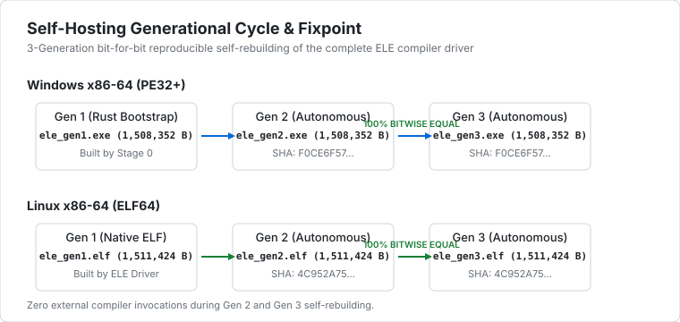
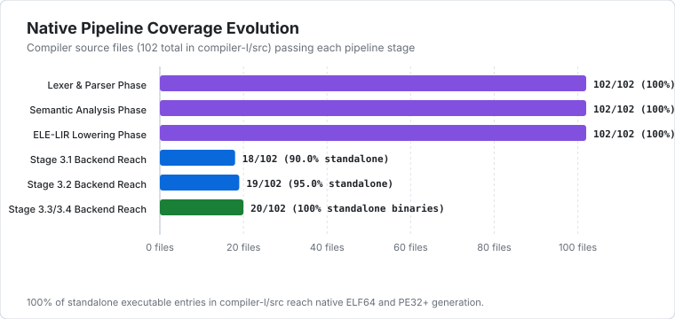

# ELE: A Self-Hosting Systems Programming Language

<p align="center">
  <a href="https://github.com/Joshua-EPR/ELE/actions/workflows/native-selfhosting-validation.yml"></a>
  <a href="https://github.com/Joshua-EPR/ELE/actions/workflows/docs-and-benchmarks.yml"></a>
  
  
  
</p>

<p align="center">
  <b>English</b> | <a href="README.es.md">Español</a>
</p>

---

## Introduction

**ELE** is an experimental, self-hosting systems programming language designed for deterministic memory safety without a garbage collector. It compiles directly to native machine code (**Windows PE32+** and **Linux ELF64**) with **zero C Runtime (CRT) or standard library dependencies**.

Unlike languages that rely on large runtime layers or external linkers, ELE features an autonomous compiler driver (`ele build`) written 100% in ELE that directly emits executable binary images, plans stack layouts, and verifies affine ownership typestate.

---

## Why ELE?

- **Compile-Time Ownership without GC:** Affine type system with deterministic drop elaboration, move semantics, and borrow checking (`view` shared loans, `edit` exclusive loans).
- **Zero-Dependency Native Binaries:** Produces tiny standalone executables (**~5 KiB**) directly from intermediate representation to x86-64 machine code without linking against `msvcrt.dll`, `ucrt.dll`, or `glibc`.
- **Autonomous Self-Hosting Fixpoint:** Demonstrated 3-generation bit-for-bit reproducible self-rebuilding on both Windows and Linux (`Gen 2 SHA256 == Gen 3 SHA256`, 0 external compiler invocations).
- **Fast Compilation Latency:** Standard modules compile natively in **30–55 ms** with low compiler memory overhead (~24.5 MiB).
- **Clean Canonical Syntax (v2):** Purpose-designed systems grammar with explicit intent: `flow`, `shape`, `choice`, `hold`, `change`, `during`, `when`, `give`.

---

## Quick Start

### 1. Installation

Install ELE using the zero-dependency user installers:

- **Windows:** Run `.\install.ps1` (installs to `$env:LOCALAPPDATA\ele\bin` and configures User PATH).
- **Linux:** Run `./scripts/install.sh` (installs to `~/.ele/bin` and configures shell PATH).

Standalone release packages (`ele-windows-x86_64.zip` and `ele-linux-x86_64.tar.gz`) contain the autonomous compiler binary with zero external toolchain dependencies.

### 2. Minimal Program (`hello.l`)

```ele
// hello.l: Standard entry point in ELE v2 syntax
flow main() {
    print("Hello from native ELE!")
}
```

### 3. Compiling with the Autonomous Driver

Once bootstrapped, ELE compiles source files directly to native executables:

**On Windows:**
```powershell
.\bin\ele.exe build hello.l -o hello.exe
.\hello.exe
# Output: Hello from native ELE!
```

**On Linux:**
```bash
./bin/ele.elf build hello.l --target elf -o hello
chmod +x hello
./hello
# Output: Hello from native ELE!
```

For bootstrapping instructions from source, consult the [Getting Started Guide](docs/getting-started.md).

---

## Language Syntax at a Glance

```ele
// Declarations
shape Vector2 {
    x: Int
    y: Int
}

choice Result {
    Success(value: Int)
    Failure(code: Int)
}

// Functions & Control Flow
flow compute_magnitude(v: view Vector2) => Int {
    give v.x * v.x + v.y * v.y
}

flow main() => Int {
    // Immutable owner binding
    hold pos = Vector2(x: 3, y: 4)

    // Borrowing pos via shared view
    hold mag = compute_magnitude(pos)

    // Mutable variable
    change counter: Int = 0
    during counter < 3 {
        print("Magnitude iteration: {mag}")
        counter = counter + 1
    }

    give 0
}
```

Read the complete [Language Reference](docs/language-reference.md) for detailed specifications of types, collections (`List of[T]`), and borrow checking.

---

## Performance & Benchmarks

All performance claims in ELE are backed by auditable, automated benchmarks executed on physical hardware (Intel x86-64, Windows 10 & WSL2 Ubuntu). No numbers or charts are simulated.

For complete methodology, raw data, and statistical distributions, see [Performance Report](docs/performance.md) and [Benchmark Methodology](docs/benchmarks/methodology.md).

### Compilation Latency

ELE compiles small and medium programs in tens of milliseconds:

<p align="center">
  
</p>

| Workload | Source Lines | Median Compile Time | Compiler Peak RSS | Output Size |
|---|---|---|---|---|
| `hello.l` | 5 | **31.4 ms** | 24.50 MiB | 4,608 B |
| `arithmetic.l` | 10 | **36.1 ms** | 24.52 MiB | 5,120 B |
| `fibonacci.l` | 13 | **38.7 ms** | 24.52 MiB | 5,120 B |
| `text_processing.l` | 10 | **39.2 ms** | 24.52 MiB | 5,120 B |
| `multimodule (main.l)` | 10 | **54.7 ms** | 40.59 MiB | 5,120 B |
| `main_sema.l` (Compiler) | 274 | **15.64 s** | 525.11 MiB | 909,824 B |
| `main_driver.l` (Self-Host) | 665 | **31.30 s** | 855.04 MiB | 1,508,352 B |

---

### Memory Usage During Compilation

Compiler memory overhead is tracked continuously through kernel accounting APIs (Windows Job Objects `PeakProcessMemoryUsed` and Linux `getrusage`):

<p align="center">
  
</p>

---

### Runtime Performance Comparison

We evaluate identical algorithms across **ELE**, **Rust (`rustc 1.99.1`)**, and **C (`gcc 9.4.0`)** producing verified mathematical outputs:

<p align="center">
  
</p>

| Benchmark | Language | Optimization Level | Compile Time | Runtime (ms) | Binary Size |
|---|---|---|---|---|---|
| **Fibonacci(25)** | **ELE** | `native-direct-emit` | **40.6 ms** | **28.37 ms** | **5,120 B** |
| Fibonacci(25) | Rust | Debug (`-O0`) | 657.6 ms | 20.72 ms | 5,086,801 B |
| Fibonacci(25) | Rust | Release (`-O3`) | 718.6 ms | 21.02 ms | 5,085,050 B |
| **Loop(10M)** | **ELE** | `native-direct-emit` | **48.9 ms** | **101.42 ms** | **5,120 B** |
| Loop(10M) | Rust | Debug (`-O0`) | 674.9 ms | 103.11 ms | 5,086,761 B |
| Loop(10M) | Rust | Release (`-O3`) | 692.6 ms | 21.40 ms | 5,084,972 B |

> [!NOTE]
> ELE's native backend emits direct machine code from CFG blocks without SSA optimization passes. Its execution speed is directly comparable to unoptimized debug builds of C and Rust, while compiling in a fraction of the time.

---

### Binary Footprint

Because ELE binaries do not link against the C runtime library or bundle a heavy standard library runtime, generated executables are orders of magnitude smaller:

<p align="center">
  
</p>

---

## Self-Hosting & Generational Reproducibility

ELE has established autonomous, bit-for-bit generational self-rebuilding across Windows and Linux.

<p align="center">
  
</p>

- **Windows Fixpoint:** `Gen 2 SHA256 == Gen 3 SHA256` (`F0CE6F57427B5A60D51095975A85A56D5FD43F18DC4FA2F732DA0D02E0B5370D`)
- **Linux Fixpoint:** `Gen 2 SHA256 == Gen 3 SHA256` (`4C952A75B28AEB5BE6770372BA426137A32E0C7B0C5A31E798B235E97CE4E9E9`)
- **External Invocations:** **0** (neither `rustc`, `cargo`, `gcc`, nor `link.exe` are called during Gen 2 and Gen 3 builds).

For the full architectural report, read [Self-Hosting Documentation](docs/self-hosting.md).

---

## Native Pipeline Coverage

<p align="center">
  
</p>

- **102 / 102 source files (100%)** in `compiler-l/src/` pass the Lexer, Parser, and Semantic Analysis phases.
- **20 / 102 source files (~19.6%)** reach native backend emission; these are the **20 / 20 standalone compiler entry points** in the current coverage matrix. This is not 100% full-source backend coverage.

---

## Compiler Architecture

ELE's compiler pipeline is organized into distinct, modular verification layers:

```text
Source .l ──► Lexer ──► Parser ──► Sema & Types ──► Borrow Checker ──► ELE-LIR ──► CFG ──► x86-64 Emitter ──► PE32+ / ELF64
```

See [Compiler Architecture](docs/architecture.md) for technical deep-dives into Pratt parsing, typestate verification, and x86-64 instruction encoding.

---

## Project Status & Roadmap

ELE is an active research and development systems language. While the compiler driver and standalone programs are fully functional and self-hosted, ELE is not yet recommended for production mission-critical environments.

See [Known Limitations](docs/limitations.md) and [Development Roadmap](docs/roadmap.md) for details on planned features, including ARM64 support, SSA register allocation, and structured concurrency.

---

## Documentation Directory

- [Getting Started Guide](docs/getting-started.md)
- [Language Reference Specification](docs/language-reference.md)
- [Compiler Architecture](docs/architecture.md)
- [Self-Hosting & Generational Fixpoint](docs/self-hosting.md)
- [Performance & Benchmark Report](docs/performance.md)
- [Known Limitations & Security Constraints](docs/limitations.md)
- [Development Roadmap](docs/roadmap.md)
- [Benchmark Methodology](docs/benchmarks/methodology.md)
- [Benchmark Reproducibility Guide](docs/benchmarks/reproducibility.md)

---

## Contributing & License

Contributions, bug reports, and discussions are welcome. Please ensure that all modifications pass the quality gates:

```powershell
cargo fmt --all --check
cargo clippy --workspace --all-targets -- -D warnings
cargo test -p project-l --test ele_v2_legacy_ratchet
python benchmarks/scripts/validate_results.py
```

**License:** No repository-level license file has been published. Do not assume redistribution rights without confirming the project's terms.
