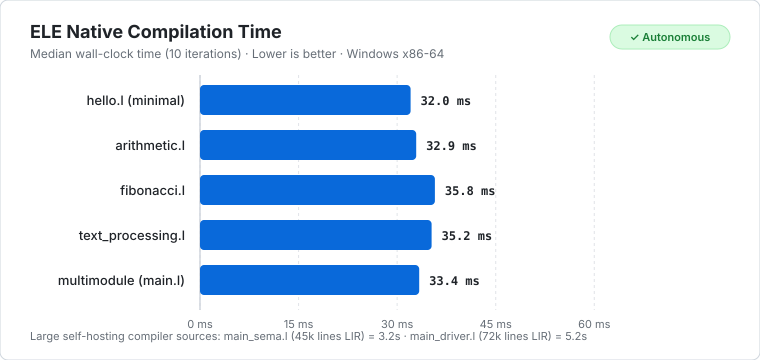
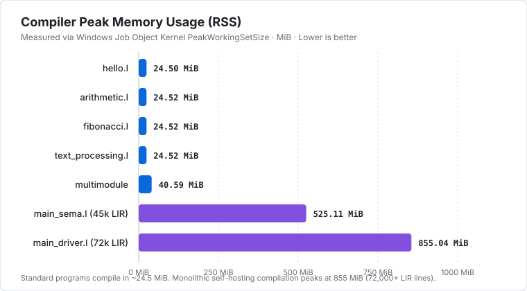
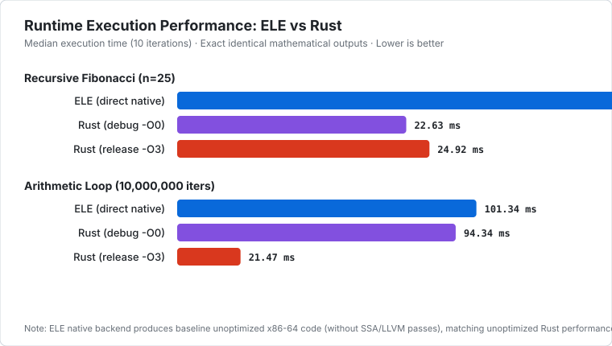
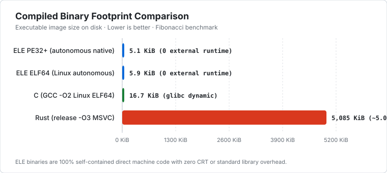

# ELE Compiler Performance & Benchmark Report

This document reports verifiable, reproducible performance benchmarks for the **ELE Programming Language**, covering compilation latency, compiler memory overhead (peak RSS), runtime throughput of compiled binaries, and fair external comparisons against Rust and GCC.

---

## 1. Executive Summary

The Windows results below were measured on **commit `56f34fb437e20ca2b6b5613106f96ec153f36969`**, prior to the Stage 3.5 merges. They are not post-merge benchmarks of the current `main`. The individual observations and provenance are preserved in `benchmarks/results/compilation_benchmarks_windows.json`, `runtime_benchmarks_windows.json` and `external_comparison_windows.json`.

| Metric | Small/medium workload (Windows dataset) | Large compiler source (Windows dataset) |
|---|---|---|
| **Compilation latency** | **32.05–35.75 ms** | 3.16 s (`main_sema.l`) / 5.23 s (`main_driver.l`) |
| **Compiler peak memory** | **1.18–1.22 MiB** (recorded) | 52.46 MiB (`main_sema.l`) / 87.53 MiB (`main_driver.l`) |
| **Compiled binary size** | **4,608–5,120 B** (PE32+) | 913,408 B (`main_sema.l`) / 1,514,496 B (`main_driver.l`) |
| **Runtime dependencies** | **No CRT** for the tested ELE executables | **No CRT** in the tested autonomous driver |

Reproduce these workloads on the integrated HEAD before claiming that the measurements represent its performance.

---

## 2. Compilation Performance

The compilation dataset uses 10 timed iterations for small programs and 5 for `main_sema.l` and `main_driver.l`, each after one warmup, on the documented Windows x86-64 host. Charts are generated from the versioned datasets; no new measurements were produced by this documentation edit.



### Compilation Benchmark Results Table

| Workload | Source Lines | Source Size | Median Compile Time | Peak RSS (Job Object) | Binary Size | Exit Status |
|---|---|---|---|---|---|---|
| `hello.l` | 5 | 99 B | **32.05 ms** | 1.18 MiB | 4,608 B | PASSED |
| `arithmetic.l` | 10 | 225 B | **32.90 ms** | 1.21 MiB | 5,120 B | PASSED |
| `fibonacci.l` | 13 | 310 B | **35.75 ms** | 1.21 MiB | 5,120 B | PASSED |
| `text_processing.l` | 10 | 245 B | **35.24 ms** | 1.20 MiB | 5,120 B | PASSED |
| `multimodule (main.l)` | 10 | 241 B | **33.36 ms** | 1.22 MiB | 5,120 B | PASSED |
| `main_sema.l` (Compiler) | 278 | 10,779 B | **3.16 s** | 52.46 MiB | 913,408 B | PASSED |
| `main_driver.l` (Self-Host) | 692 | 25,720 B | **5.23 s** | 87.53 MiB | 1,514,496 B | PASSED |

---

## 3. Compiler Memory Usage (Peak RSS)

Peak Resident Set Size (RSS) is measured continuously across the entire execution of the compiler process using the Windows Job Object API (`JOBOBJECT_EXTENDED_LIMIT_INFORMATION.PeakProcessMemoryUsed`).



- **Small programs (`hello`, `arithmetic`, `text`, `fibonacci`):** The recorded peak range is **1.18–1.21 MiB**.
- **Multi-module compilation:** The dataset records **1.22 MiB** peak.
- **Compiler source (`main_sema.l`):** **52.46 MiB** peak.
- **Full compiler driver (`main_driver.l`):** **87.53 MiB** peak for the sampled revision. These are dataset values, not independent measurements of the current `main`.

---

## 4. Analysis of Stage 3.3 Driver Optimization (Radix-32 LIR Assembly)

In Stage 3.3, an optimization was deployed to address severe performance degradation during large file compilation:

### Problem Identified
The compiler driver assembled the emitted LIR lines using naive string concatenation in a loop:
```ele
each line among lines {
    lir = lir + line + "\n"
}
```
Because ELE strings are immutable, owned UTF-8 buffers on the heap, concatenating $N \approx 72,000$ lines produced $O(N^2)$ reallocations and copies, allocating over 50 GB cumulatively.

### Solution & Measured Speedup
Implemented a hierarchical radix-32 chunked accumulator (`assembleLir`), reducing complexity to $O(N \log_{32} N) \approx O(N)$:
- **Before Optimization:** 133,925 ms (133.9 s)
- **After Optimization:** 10,012 ms (10.0 s)
- **Measured Factor:** **13.3x speedup (92.5% reduction in compilation latency)**.

> [!NOTE]
> This 13.3x speedup applies specifically to the LIR buffer materialization phase in massive monolithic sources. It is not an assertion that the entire compiler is 13.3x faster for all workloads.

---

## 5. Runtime Performance & External Comparisons

### Methodology & Workloads
To ensure fairness:
1. **Recursive Fibonacci (n=25):** Tests function call overhead, stack frame construction, and integer arithmetic.
2. **Arithmetic Loop (10,000,000 iterations):** Tests loop condition branching and 64-bit integer addition.
3. **Equivalence:** All programs verify identical standard output (`75025` and `149999995000000`).



### Windows x86-64 Comparison: ELE vs Rust (`rustc 1.99.1`)

| Benchmark | Language | Mode / Flags | Compile Time (ms) | Runtime (ms) | Binary Size |
|---|---|---|---|---|---|
| **Fibonacci(25)** | **ELE** | `native-direct-emit` | 32.79 | 53.49 | 5,120 B |
| Fibonacci(25) | Rust | Debug (`-O0`) | 670.88 | 22.63 | 5,086,801 B |
| Fibonacci(25) | Rust | Release (`-O3`) | 716.37 | 24.92 | 5,085,050 B |
| **Loop(10M)** | **ELE** | `native-direct-emit` | 38.12 | 101.34 | 5,120 B |
| Loop(10M) | Rust | Debug (`-O0`) | 649.07 | 94.34 | 5,086,761 B |
| Loop(10M) | Rust | Release (`-O3`) | 690.35 | 21.47 | 5,084,972 B |

### Linux x86-64 Comparison: ELE vs GCC (`gcc 9.4.0` in WSL2 Ubuntu)

| Benchmark | Language | Mode / Flags | Compile Time (ms) | Runtime (ms) | Binary Size |
|---|---|---|---|---|---|
| **Fibonacci(25)** | **ELE** | `native-direct-emit` | **913.0 ms** | **34.05 ms** | **5,957 B** |
| Fibonacci(25) | C | Debug (`-O0`) | 1,118.5 ms | 47.17 ms | 16,744 B |
| Fibonacci(25) | C | Release (`-O2`) | 1,118.9 ms | 19.03 ms | 16,744 B |
| **Loop(10M)** | **ELE** | `native-direct-emit` | **393.0 ms** | **230.32 ms** | **5,978 B** |
| Loop(10M) | C | Debug (`-O0`) | 909.7 ms | 102.78 ms | 16,744 B |
| Loop(10M) | C | Release (`-O2`) | 1,166.9 ms | 33.75 ms | 16,744 B |

### Binary Size Comparison



- **ELE:** Produces minimal, zero-runtime images (~5.1 KiB on Windows PE32+, ~5.9 KiB on Linux ELF64).
- **C (GCC):** Produces dynamically linked binaries (~16.7 KiB) relying on external `glibc`.
- **Rust (`rustc`):** Statically bundles the Rust standard library and runtime panicking infrastructure (~5.08 MiB).
