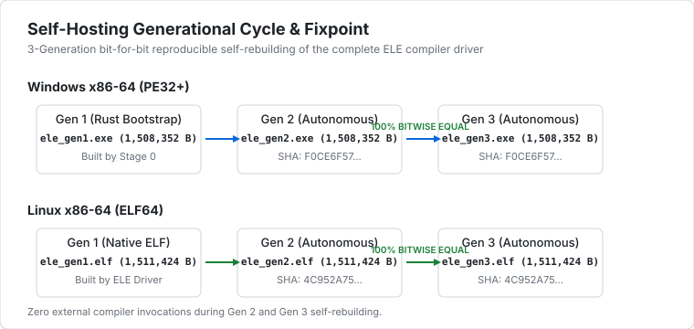
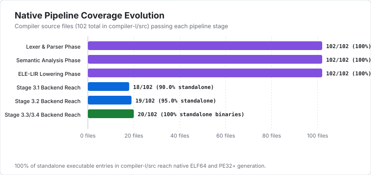

# Self-Hosting Architecture & Generational Fixpoint

This document details the self-hosting capabilities, generational build pipeline, and reproducible bit-for-bit fixpoint verification of the **ELE Programming Language**.

---

## 0. Terminology

**Stage 1** is the compiler written in ELE (`compiler-l/src/main_driver.l`, 743 lines, 28,535 B), built **without Rust** from the pinned seed:
`seed -> Gen1' -> Gen2 -> Gen3`, with `Gen2 == Gen3` bit for bit (the fixpoint). `Gen2`/`Gen3` is what the installers ship as `ele.exe` / `ele.elf`.
Other documents number the stages differently; the table that relates them, the Rust route and the comparison between both are in
[building-with-stage1.md](building-with-stage1.md). "Stage 3.x" in sections 1 and 2 below are names of engineering milestones, not compiler generations.

## 0.1 Stage 1 step by step (verified 2026-11-27)

Everything below was executed on commit `ec410984c8311f0e79e1a876932cff785f88ad13`
(Windows 10 IoT Enterprise LTSC 2021, Intel Core i5-7300U, about 8 GiB RAM). No Rust toolchain was used.

```powershell
# 1. Extract and verify the pinned seed (checks archive and payload SHA-256 and the PE32+ AMD64 header)
python tools/verify_seed_archive.py pe --output .\seed\ele-seed-pe.exe
#   verified PE32+ AMD64 seed: ...\seed\ele-seed-pe.exe   (1,220,096 B = 1,191.5 KiB)

# 2. Bootstrap: seed -> Gen1' -> Gen2 -> Gen3, smoke and reject tests, provenance
.\scripts\bootstrap\ele_seed_bootstrap.ps1 `
    -Seed .\seed\ele-seed-pe.exe `
    -SeedSha256 eb98a908ca5a36b5a4f29c9114a8232a6031f7d35c2c4298569adf67ebccc2f5 `
    -Target pe -OutDir .\out\bootstrap
```

Parameters (the `param()` block of the script): `-Seed` and `-SeedSha256` (mandatory), `-Target pe` (the only value),
`-OutDir` (mandatory; must not exist or be empty), `-RepoRoot` (default: the repository that contains the script),
`-ForbidToolchainOnPath` (error if the Rust toolchain is on `PATH`) and `-TimeoutSeconds` (default 600).

Key output observed:

```text
    seed sha256 eb98a908ca5a36b5a4f29c9114a8232a6031f7d35c2c4298569adf67ebccc2f5 (matches pin)
    gen1prime sha256 634f77c44cab756c15007fe2aaa09b2b8ddcc82ee7eece77e0a4773b3a8885bf (2438656 bytes, 3.39 s)
    gen2 sha256 cfcfa798f9b5680721184de780bbeed8566947962828e4cc49471407f063d218 (2438656 bytes, 13.33 s)
    gen3 sha256 cfcfa798f9b5680721184de780bbeed8566947962828e4cc49471407f063d218 (2438656 bytes, 13 s)
    BITWISE EQUAL (gen1prime == gen2: False)
    (7 smoke programs ok, 4 reject programs ok)
==> OK: Stage-0-free chain seed -> gen1prime -> gen2 -> gen3 is a bitwise fixpoint (cfcfa798...)
```

| Output (`-OutDir`) | Content |
|---|---|
| `seed.exe` | Verified copy of the seed (1,220,096 B) |
| `gen1prime.exe`, `gen2.exe`, `gen3.exe` | 2,438,656 B (2,381.5 KiB) each; Gen2 and Gen3 are identical |
| `provenance.json`, `SHA256SUMS` | Commit, source hash, SHA-256, size and seconds per generation, smoke results |
| `logs/`, `smoke/` | Compiler logs and the compiled smoke programs |

Total time: 31.8 s on the host above (3.4 s + 13.3 s + 13.0 s plus the smoke tests). `Gen1' != Gen2` is normal: the seed was
produced by an older revision of the compiler, so Gen1' is only the first output of the current source. The fixpoint is `Gen2 == Gen3`.

**Current fixpoint (Windows PE32+, commit `ec41098`):** `cfcfa798f9b5680721184de780bbeed8566947962828e4cc49471407f063d218`, 2,438,656 B.
Data: [`benchmarks/campaign_20261127_stage1/bootstrap/`](benchmarks/campaign_20261127_stage1/bootstrap/).

The SHA-256 recorded in `kernel/compilador/provenance.json` is the same value, but that file was produced from a dirty tree at `758270d`;
a clean `758270d` gives a different fixpoint. The explanation is in [building-with-stage1.md](building-with-stage1.md#about-the-fixpoints).

### Using the Stage 1 compiler

`gen2.exe` (or `gen3.exe`, the same bytes) is the compiler. Copy it to a name and folder of your choice, for example
`bin\ele.exe`; it needs nothing else.

```powershell
.\gen2.exe build hola.l -o hola.exe                           # Windows PE32+ (default on Windows)
.\gen2.exe build hola.l --target elf -o hola                  # Linux ELF64 (checked: runs under WSL and prints the expected text)
.\gen2.exe build main.l -o app.exe                            # `take <module>` resolves next to main.l (checked with a 2-module program)
.\gen2.exe build prog.l --lib . -o prog.exe                   # also search missing imports under the root '.' (e.g. std/)
.\gen2.exe build k.l --target kernel --entry kmain -o k.elf   # freestanding ELF64, no runtime (no print, Text or List)
.\gen2.exe --version                                          # ele 0.3.0 (Stage 3 self-hosted native driver)
```

Options (from `printHelp` in `compiler-l/src/main_driver.l`): `--output`/`-o`, `--target <elf|pe>` or `--target kernel`, `--pe64`,
`--elf64`, `--lib <root>`, `--entry <flow>` (default `main`, `kmain` with `--target kernel`), `--help`/`-h`, `--version`/`-v`.
Checked: a kernel program that calls `print` is rejected (`error[BACKEND]: --target kernel no tiene runtime ...`, exit 3), and
writing over the source file is refused (`error[CLI]: el archivo de salida no puede sobrescribir ...`, exit 2).

Compiled **and run** with `gen2.exe` on this commit, stdout as expected in every case (also identical to the output of the Rust-built compiler): `examples/hello.l`,
`fibonacci.l`, `loops.l`, `structs.l`, `text.l`, `native_text_stage1.l`, `benchmarks/sources/arithmetic.l`, `text_processing.l`,
`comparisons/fibonacci_recursive.l`, `comparisons/arithmetic_loop.l` and 10 programs of `bench/programs/`. All 36 files of `examples/*.l`
compile (the `native_*` ones were compiled but not run), and `compiler-l/src/main_driver.l` compiles to a file equal to Gen2.
Programs that use `async`, `spawn` or regions are not accepted by Stage 1 yet (list in the
[campaign README](benchmarks/campaign_20261127_stage1/README.md)).

Performance of this compiler and of its output: [performance.md](performance.md#0-measurements-2026-11-27-stage-1); the comparison with the Rust reference compiler: [building-with-stage1.md](building-with-stage1.md).

---

## 1. Overview of Self-Hosting in ELE

A programming language is considered self-hosting when a compiler written in that language can compile its own source code to produce a functional executable.

In ELE:
- The unified driver (`compiler-l/src/main_driver.l`) is written **100% in ELE v2 syntax**.
- It incorporates the full compilation pipeline: parsing, semantic analysis, ownership verification, LIR emission, CFG transformation, and native x86-64 machine code generation.
- Stage 3.2 established the first cross-platform generational fixpoint.
- Stage 3.3 hardened this pipeline with strict filesystem safety, atomic staging (`.tmp.ele`), and expanded codegen capacities (32 MiB code / 64 MiB heap reserve).



---

## 2. Generational Verification Experiment

> **Historical (Stage 3.2/3.3 chain, before 2026-11-20).** The hashes (`F0CE6F57...`, `4C952A75...`) and sizes (1,508,352 B and
> 1,511,424 B) below belong to an older source revision whose Gen 1 came from the previous route (see [building-with-stage1.md](building-with-stage1.md#about-the-fixpoints)). The current Windows fixpoint is the one in
> section 0.1 (2,438,656 B, `cfcfa798...`). The Linux chain was not re-run on 2026-11-27.

The self-hosting reproducibility experiment executes a 3-generation circular compilation process:

```text
       [Stage 0 (Rust Seedling)]
                  │
                  ▼ compiles main_driver.l
           [Gen 1 Binary]
                  │
                  ▼ compiles main_driver.l (Zero external tools)
           [Gen 2 Binary]
                  │
                  ▼ compiles main_driver.l (Zero external tools)
           [Gen 3 Binary]
                  │
                  ▼ Check: SHA256(Gen 2) == SHA256(Gen 3)
```

### Windows x86-64 Chain (PE32+)

| Generation | Binary Image | Size (Bytes) | SHA-256 Digest | External Invocations |
|---|---|---|---|---|
| **Gen 1** | `ele_gen1.exe` | 1,508,352 | *(Bootstrap reference)* | 1 (Stage 0 Rust compiler) |
| **Gen 2** | `ele_gen2.exe` | 1,508,352 | `F0CE6F57427B5A60D51095975A85A56D5FD43F18DC4FA2F732DA0D02E0B5370D` | **0** |
| **Gen 3** | `ele_gen3.exe` | 1,508,352 | `F0CE6F57427B5A60D51095975A85A56D5FD43F18DC4FA2F732DA0D02E0B5370D` | **0** |

**Bitwise Equality:** `Gen 2 == Gen 3` byte-for-byte identical fixpoint achieved.  
**Functional Verification:** `ele_gen3.exe` compiled `hello.l` to `hello_by_gen3.exe`, which ran with exit code 0.

### Linux x86-64 Chain (ELF64 / WSL2 Ubuntu)

| Generation | Binary Image | Size (Bytes) | SHA-256 Digest | External Invocations |
|---|---|---|---|---|
| **Gen 1** | `ele_gen1.elf` | 1,511,424 | *(Built by ELE driver)* | **0** |
| **Gen 2** | `ele_gen2.elf` | 1,511,424 | `4C952A75B28AEB5BE6770372BA426137A32E0C7B0C5A31E798B235E97CE4E9E9` | **0** |
| **Gen 3** | `ele_gen3.elf` | 1,511,424 | `4C952A75B28AEB5BE6770372BA426137A32E0C7B0C5A31E798B235E97CE4E9E9` | **0** |

**Bitwise Equality:** `Gen 2 == Gen 3` byte-for-byte identical fixpoint achieved.  
**Functional Verification:** `ele_gen3.elf` compiled `hello.l` in Linux to `hello_by_gen3.elf`, which executed natively with exit code 0.

---

## 3. Scope of Self-Hosting & Autocobertura

While the driver `main_driver.l` is fully self-hosted, we maintain strict scientific accuracy regarding project-wide coverage:

- **Compiler Driver:** 100% self-hosted and self-rebuilding.
- **Standalone Executables:** 20 out of 20 standalone tools in `compiler-l/src/` reach the native backend (100% of standalone executables).
- **Total Repository Sources:** 102 source files in `compiler-l/src/`:
  - **102 / 102 (100%)** reach the Lexer & Parser phase.
  - **102 / 102 (100%)** reach Semantic Analysis.
  - **102 / 102 (100%)** reach ELE-LIR lowering.
  - **20 / 102 (19.6%)** compile to standalone native executables (the remaining 82 files are sub-modules imported by the standalone drivers).



---

## 4. Reproducing the Self-Hosting Fixpoint

To reproduce the exact generational verification on your machine:

```powershell
# Set distro environment for Linux execution on Windows hosts
$env:ELE_TEST_WSL_DISTRO = "Ubuntu"

# Run the full integration test suite verifying fixpoints
cargo test -p project-l --test ele_build_driver_l driver_builds_self_rebuild_windows_fixpoint
cargo test -p project-l --test ele_build_driver_l driver_builds_self_rebuild_linux_fixpoint
```
Both tests assert bitwise equality (`assert_eq!(bytes_gen2, bytes_gen3)`) and execute the Gen 3 binary.
