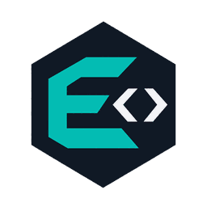
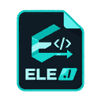

# ELE Language Support for Visual Studio Code



The ELE emblem is the extension icon; the matching document icon identifies `.l` source files.

**Version 0.1.4:** The extension emblem is now a simplified, non-neon symbol optimized for 16–32px readability. The `.l` source document icon and Graphite Dark syntax colors remain unchanged.



Official Visual Studio Code extension providing first-class developer tooling for the **ELE** programming language (ELE v2 syntax).

## Features

- **Full Syntax Highlighting (ELE v2 Grammar)**:
  - Canonical declaration keywords: `flow`, `shape`, `choice`, `extend`, `contract`, `fixed`, `take`, `space`, `zone`, `expose`.
  - Canonical control flow keywords: `when`, `otherwise`, `during`, `repeat`, `leave`, `proceed`, `each`, `among`, `give`, `choose`.
  - Ownership & Borrowing modifiers: `hold`, `change`, `exclusive`, `direct`, `view`, `edit`.
  - Asynchronous keywords: `later`, `wait`, `launch`.
  - Implicit receiver: `this` (and `self` legacy alias).
  - Explicit Generics: `of[T]`, e.g., `shape Box of[T]`, `flow id of[T](x: T) => T`, `List of[Int]`.
  - Canonical Method Invocations: `target@method(arg)` and `Type@direct_method()`.
  - String Interpolation: `"{variable}"` expressions with full recursive highlighting.
  - Line (`//`) and block (`/* ... */`) comments.
  - Transitional support for legacy alias tokens (`fn`, `let`, `var`, `struct`, etc.).

- **ELE v2 Code Snippets**:
  - `flow`: Function declaration
  - `shape`: Nominal data shape (struct)
  - `choice`: Algebraic enum
  - `extend`: Method implementations (`extend Type` and `extend Contract on Type`)
  - `contract`: Interface / trait declaration
  - `hold`: Immutable variable declaration
  - `change`: Mutable variable declaration
  - `fixed`: Constant definition
  - `give`: Explicit return
  - `when` / `otherwise`: Conditional branching
  - `during`: Conditional loop (`while`)
  - `each`: Collection iteration loop (`each ... among`)
  - `take`: Module import
  - `expose`: Public visibility modifier
  - `choose`: Exhaustive pattern matching (`choose expr { Pattern: { ... } }`)
  - `repeat`: Unconditional loop
  - `exclusive flow`, `direct flow`, `later flow`

- **Language Configuration**:
  - Brackets and delimiter auto-closing (`{}`, `[]`, `()`, `""`, `/**/`).
  - Indentation rules for braces and control blocks.
  - Code folding regions (`//#region` / `//#endregion`).

- **Compiler Diagnostic Integration (Problem Matcher `$ele`)**:
  - Automatically parses diagnostic output from the ELE driver (`ele build <file.l>`):
    `{filepath}:{line}:{column}: error[{code}]: {message}`
    and parser diagnostics:
    `{filepath}:{line}:{column}: error[PARSER]: {message}`
  - Enables one-click navigation directly from the VS Code Problems panel to source code locations.

---

## Configuring Tasks with the `$ele` Problem Matcher

To build ELE source files and have compiler errors display interactively in your VS Code Problems tab, add the following task to `.vscode/tasks.json` in your workspace:

```json
{
  "version": "2.0.0",
  "tasks": [
    {
      "type": "shell",
      "label": "ele: build current file",
      "command": "ele",
      "args": ["build", "${file}"],
      "problemMatcher": ["$ele"],
      "group": {
        "kind": "build",
        "isDefault": true
      },
      "presentation": {
        "reveal": "always",
        "panel": "shared"
      }
    }
  ]
}
```

Whenever `ele build` emits an error such as:
```text
src/main.l:14:5: error[L0005]: uso de valor movido
src/main.l:22:1: error[PARSER]: se esperaba expresión
```
VS Code will populate the Problems panel, underline the offending token in the editor, and jump to the exact line and column upon clicking.

---

## ELE Graphite Dark — optional editor colors

The extension normally **inherits the active VS Code color theme**. Its TextMate grammar identifies ELE syntax scopes, but does not force a palette on the user's editor.

This extension now also provides the optional **ELE Graphite Dark** theme, intended for more restrained, readable ELE code:

| Syntax role | Example | Color |
|---|---|---|
| Declarations | `flow`, `take`, `shape` | muted teal `#83C6BC` |
| Flow control | `when`, `give`, `each` | soft coral `#D8AD98` |
| Ownership | `hold`, `change`, `view`, `edit` | soft blue-gray `#B9C5E0` |
| Types | `Float`, `List`, `Microcolumn` | muted gold `#E7C38C` |
| Functions and methods | `main()`, `@crear()`, `@reset()` | calm blue `#82BFE9` |
| Strings | `"hello"` | sage `#A7CFA0` |
| Local variables | `input`, `weights`, `column` | seafoam `#B6D7C7` |
| Parameters | `pre`, `post` | soft blue `#AEC9E6` |
| Object fields | `column.activeCount` | sandstone `#CECEAB` |
| Named constants | `fixed MAX_WEIGHTS`, `MAX_WEIGHTS` | amber `#E8B68D` |
| Numbers | `0.8`, `31` | apricot `#DCAA87` |
| Comments | `// detail` | slate `#708494` |

**How it highlights names:** Declarations with `hold` and `change`, function parameters, member fields and ordinary lowercase variable references are colored independently. `fixed` declarations receive the constant color. References written in `UPPER_SNAKE_CASE` also receive the constant color. **TextMate highlighting is lexical, not a full name resolver:** references to lowercase `fixed` names use the variable color until ELE supports semantic tokens. The change does not modify compiler semantics.

**Enable it:** Press `Ctrl+Shift+P`, select **Preferences: Color Theme**, and choose **ELE Graphite Dark**. Use the same menu to switch back to your previous theme. The choice affects editor/UI appearance, not compiler behavior, syntax, or generated code.

**Development mode:** from `editors/vscode`, run `code --extensionDevelopmentPath=. --new-window` to open an Extension Development Host with the local extension loaded; select **ELE Graphite Dark** there. If you change the JSON afterward, reload the development window. For an installed VSIX, package and reinstall the updated extension.

---

## ELE branded icons

- **Extension icon:** The ELE emblem is shown in VS Code's Extensions view through the `icon` field in `package.json`.
- **File icon:** ELE contributes `images/ele-file.png` as the default file icon for language ID `ele`, in both light and dark themes. VS Code uses it only when your selected file-icon theme allows language icons and does not already assign a higher-priority icon to `.l`. <https://code.visualstudio.com/api/extension-guides/file-icon-theme>
- **Guaranteed visual choice:** To select the included icon set, open **Preferences: File Icon Theme** from the Command Palette and choose **ELE File Icons**. This is an optional *whole file icon theme*, so it may change the appearance of other file types. To keep your current file-icon theme, leave it selected and use the ELE language fallback when supported.

These icons do not change file associations, syntax, the `.l` extension, or the compiler.

---

## Local Installation

### Method 1: Extension Folder Link (Development Mode)
Copy or symlink the `editors/vscode` directory into your VS Code extensions folder:
- **Windows**: `%USERPROFILE%\.vscode\extensions\ele-vscode`
- **Linux / macOS**: `~/.vscode/extensions/ele-vscode`

### Method 2: Package to VSIX
Using `@vscode/vsce`:
```bash
cd editors/vscode
npx @vscode/vsce package
code --install-extension ele-vscode-0.1.4.vsix
```

---

## ELE v2 Code Sample

```ele
take system.io

expose shape Point of[T] {
    x: T,
    y: T,
}

extend of[T] Point of[T] {
    direct flow new(x: T, y: T) => Point of[T] {
        give Point(x: x, y: y)
    }

    exclusive flow shift(dx: T, dy: T) {
        this.x += dx
        this.y += dy
    }
}

flow main() => Int {
    change pt = Point@new(10, 20)
    pt@shift(5, -2)
    hold msg = "Point: ({pt.x}, {pt.y})"
    give 0
}
```

---

## License

Apache-2.0 or MIT. See main repository LICENSE for details.
